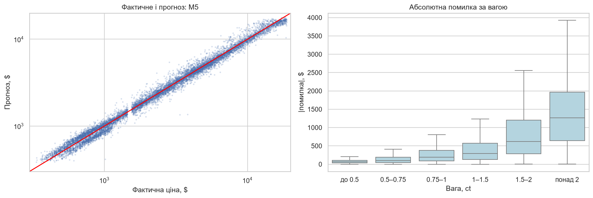

```{python}
import json
import pandas as pd
from IPython.display import Markdown
K = json.load(open("results/key_numbers.json", encoding="utf-8"))
usd = lambda v: f"{v:,.0f}".replace(",", " ") + " $"
short = lambda t: t.split(" ")[0]
```

## Питання і дані

- **Питання:** наскільки точно 4C (вага, огранка, колір, чистота) прогнозують ціну нового діаманта і як
  ціна пов'язана з вагою за однакової якості?
- **Дані:** `diamonds` (ggplot2), `{python} f"{K['n_clean']:,}".replace(",", " ")` каменів після очищення,
  ціна в $ (2008 р.)
- **Поділ:** 80/20, `seed = 42`; вибір моделі за 5-кратною CV лише на навчальній частині
- **Основна метрика:** MAE, $ (ціна дуже асиметрична)

## Гіпотези (з літератури та EDA → розвідувальні)

- **H1.** Еластичність ціни за вагою > 1 за сталих cut, color, clarity [Chu 2001]
- **H2.** Ціна монотонно зростає з чистотою; надбавка IF над I1 > 100 %
- Модифікація з літератури: стрибки ціни на «круглих» вагах 0.5 / 1 / 1.5 / 2 ct [Scott & Yelowitz 2010]

## Ключовий графік EDA


Ціна асиметрична (`{python} K["skew_price"]`) → моделюємо ln(ціна); у log–log майже пряма, але є «сходинки» на круглих вагах.

## Базова регресія і діагностика

{width=100%}

- M1 (ціна в $): дуга, лійка, `{python} K["m1_neg"]` від'ємних прогнозів → беремо **M2**: ln(price) ~ ln(carat) + cut + color + clarity, R² = `{python} K["r2_m2"]`
- Хвиля залишків M2 зі зламами на 0.5 / 1 / 1.5 / 2 ct (б) → **M3**: сплайн і пороги ваги
- Впливових точок немає: max D Кука `{python} K["cook_max"]`; без 1 % найвпливовіших β майже не змінюється

## Гіпотези: результат (M2, 95 % ДІ, HC3)

- **H1:** β ln(carat) = **`{python} K["b1"]`** [`{python} K["b1_lo"]`; `{python} K["b1_hi"]`] → вдвічі важчий камінь ≈ у 3.7 раза дорожчий ✔
- **H2:** надбавка за чистоту зростає монотонно; IF над I1 = **+`{python} K["if_prem"]` %** [`{python} K["if_lo"]`; `{python} K["if_hi"]`] ✔
- Колір D над J: +`{python} K["d_prem"]` %; огранка Ideal над Fair: лише +`{python} K["ideal_prem"]` %

## Порівняння моделей (5-кратна CV)

```{python}
cvt = pd.read_csv("results/cv_comparison.csv")
cvt["модель"] = ["M0 константа", "M1 лінійна, $", "M2 log–log", "M3 + сплайн і пороги", "M4 + взаємодії", "M5 бустинг"]
cvt.style.hide(axis="index")
```

Правило (зафіксоване до тесту): найменший середній MAE → **`{python} K["chosen"]`**; для інтерпретації — найкраща лінійна **M4**

## Тест (один раз)

```{python}
tt = pd.read_csv("results/test_metrics.csv")
tt["модель"] = tt["модель"].map(short)
tt.style.hide(axis="index").format(precision=3, thousands=" ", subset=["R²"]).format(precision=1, subset=["медіана |помилки| / ціна, %"])
```

{width=78%}

Помилка в $ росте з вагою: камені ≥ 1.5 ct — `{python} K["share_big_n"]` % тесту, але `{python} K["share_big_err"]` % сумарної помилки.

## Висновки й межі

- 4C прогнозують ціну з типовою помилкою ≈ 6–7 %; MAE `{python} usd(K["test"][1]["MAE, $"])` проти `{python} usd(K["test"][0]["MAE, $"])` у константи
- H1 і H2 узгоджуються з даними, але це **асоціації** та розвідувальна перевірка (гіпотези з EDA)
- Межі: один ринок, 2008 р., круглі камені, ціни ≤ 18 823 $; немає продавця, лабораторії, флуоресценції
- Далі: свіжі дані з кількох магазинів як справді незалежний тест
