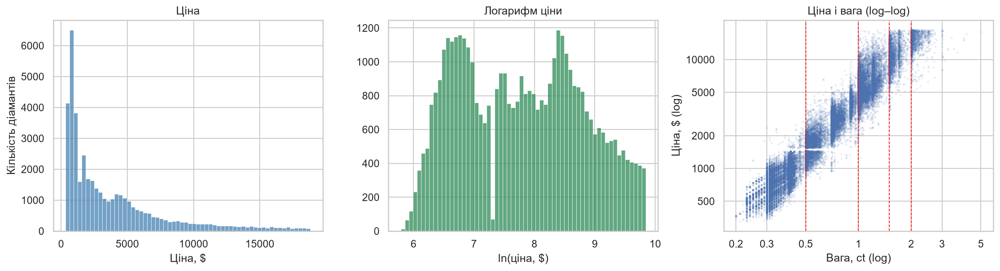
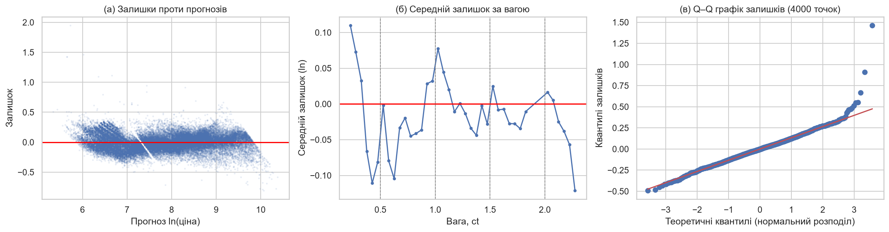

```{python}
import json
import pandas as pd

K = json.load(open("results/key_numbers.json", encoding="utf-8"))


def usd(value):
    return f"{value:.0f} $"


def num(value):
    return f"{value}".replace(".", ",")


n_clean = f"{K['n_clean']:,}".replace(",", " ")
best_test = K["test"][1]
const_test = K["test"][0]
```

## Що я досліджував

- Головне питання: чи можна вгадати ціну діаманта, знаючи лише чотири характеристики з його
  сертифіката — вагу, огранку, колір і чистоту?
- Друге питання: на скільки дорожчає камінь, коли він важчий, а якість та сама?
- Дані: `{python} n_clean` діамантів з онлайн-каталогу 2008 року (набір diamonds з пакета ggplot2).
  Ціна — у доларах.

## Як я перевіряв

- Одразу розділив дані: 80 % каменів — для навчання моделей, 20 % сховав для фінальної перевірки
  (поділ випадковий, seed = 42).
- Моделі порівнював лише на навчальній частині: 5 разів навчав на 4/5 даних і перевіряв на решті
  (перехресна валідація).
- Головна міра якості — MAE: на скільки доларів у середньому помиляється прогноз. Чим менше, тим краще.

## Мої здогадки (гіпотези)

- H1. Ціна росте швидше за вагу: камінь удвічі важчий коштує більш ніж удвічі дорожче (Chu, 2001).
- H2. Чим чистіший камінь, тим він дорожчий; найчистіший (IF) щонайменше вдвічі дорожчий за найгірший (I1).
- Ще одна підказка з літератури: ціна стрибає на «круглих» вагах — 0,5, 1, 1,5 і 2 карата
  (Scott і Yelowitz, 2010).
- Здогадки підказали ті самі дані в лаб. №2, тому перевірка попередня (розвідувальна).

## Що показали дані

{width=100%}

- Ліворуч: більшість каменів дешеві, лише кілька дуже дорогі. Після логарифма (посередині) розподіл
  рівний, тому я працюю з логарифмом ціни.
- Праворуч: ціна росте з вагою майже по прямій, але на круглих вагах видно «сходинки».

## Перша модель і перевірка її помилок

{width=100%}

- Проста формула в доларах (M1) погана: `{python} K["m1_neg"]` каменів отримали від'ємну ціну.
  Тому беру формулу з логарифмами (M2): вона пояснює 98 % розкиду цін.
- Графік (б): модель помиляється біля круглих ваг, тож у наступній моделі (M3) додаю «сходинки» ваги.
- Окремі незвичні камені результат не псують (максимальна відстань Кука `{python} num(K["cook_max"])`).

## Чи підтвердились здогадки

- H1 — так. Камінь на 1 % важчий коштує на `{python} num(round(K["b1"], 2))` % дорожче
  (95 % довірчий інтервал `{python} num(K["b1_lo"])`–`{python} num(K["b1_hi"])`).
  Удвічі важчий — приблизно в 3,7 раза дорожчий.
- H2 — так. Ціна росте з кожним кращим рівнем чистоти; IF дорожча за I1 на `{python} K["if_prem"]` %
  (інтервал `{python} K["if_lo"]`–`{python} K["if_hi"]` %).
- Для порівняння: найкращий колір додає `{python} K["d_prem"]` %, а найкраща огранка — лише
  `{python} K["ideal_prem"]` %.
- Кожна надбавка — для каменів, у яких усі інші характеристики однакові.

## Порівняння шести моделей

```{python}
cv = pd.read_csv("results/cv_comparison.csv")
plain = [
    "M0 — завжди називає середню ціну",
    "M1 — проста формула в доларах",
    "M2 — формула з логарифмами",
    "M3 — M2 + «сходинки» на круглих вагах",
    "M4 — M3 + колір і чистота разом",
    "M5 — бустинг (багато дерев рішень)",
]
table = pd.DataFrame({
    "Модель": plain,
    "Середня помилка, $": cv["MAE, $"].astype(str) + " ± " + cv["± MAE"].astype(str),
})
table.style.hide(axis="index")
```

- Чим нижче в таблиці, тим точніша модель. «±» — наскільки помилка коливається між п'ятьма перевірками.
- Правило вибору я записав заздалегідь: найменша помилка. Тому для прогнозу — бустинг (M5).
- Для пояснення зв'язків беру формулу (M4), бо бустинг не дає зрозумілих коефіцієнтів.

## Фінальна перевірка на схованих 20 %

```{python}
test_table = pd.DataFrame({
    "Модель": ["M0 — середня ціна", "M5 — бустинг (обрана)", "M4 — найкраща формула"],
    "Середня помилка, $": [row["MAE, $"] for row in K["test"]],
    "Типова помилка, %": [num(row["медіана |помилки| / ціна, %"]) for row in K["test"]],
})
test_table.style.hide(axis="index")
```

{width=64%}

- Бустинг помиляється в середньому на `{python} usd(best_test["MAE, $"])` (близько 6 % ціни), а «завжди середня ціна» — на `{python} usd(const_test["MAE, $"])`.
- Найбільші помилки — у великих дорогих каменях: `{python} K["share_big_n"]` % каменів дають `{python} K["share_big_err"]` % усієї помилки.

## Висновки

- Чотири характеристики з сертифіката дозволяють вгадати ціну з помилкою близько 6 %.
- Найбільше на ціну впливає вага; серед якісних характеристик — чистота, найменше — огранка.
- Це зв'язки в даних, а не причини: дані лише спостерігались.
- Обмеження: дані 2008 року, один ринок, лише круглі камені, ціни до 18 823 $.
- Що далі: перевірити модель на свіжих даних з кількох магазинів.

Дякую за увагу!
